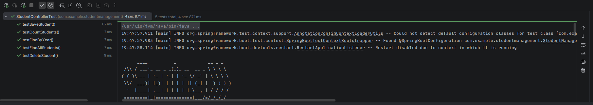
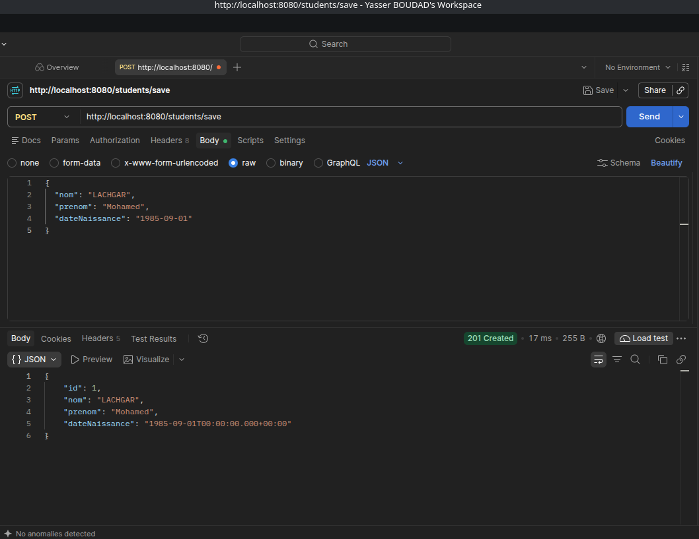
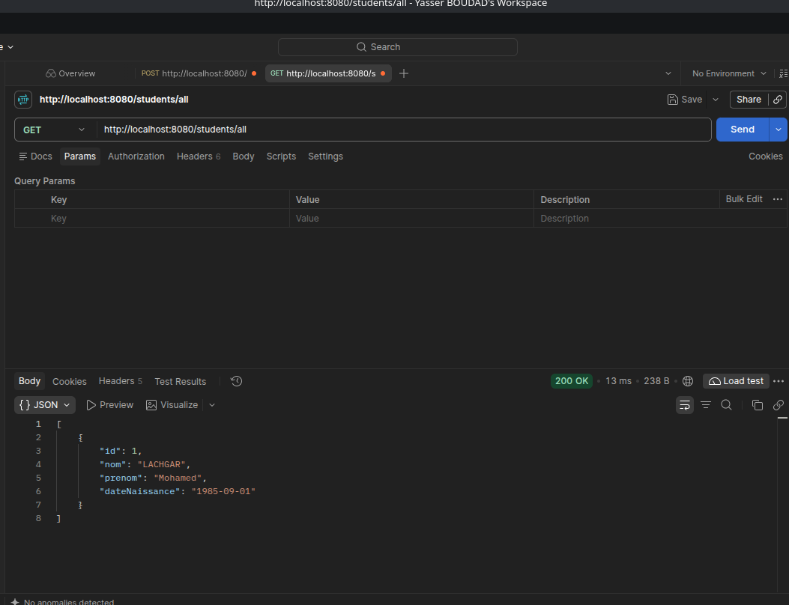
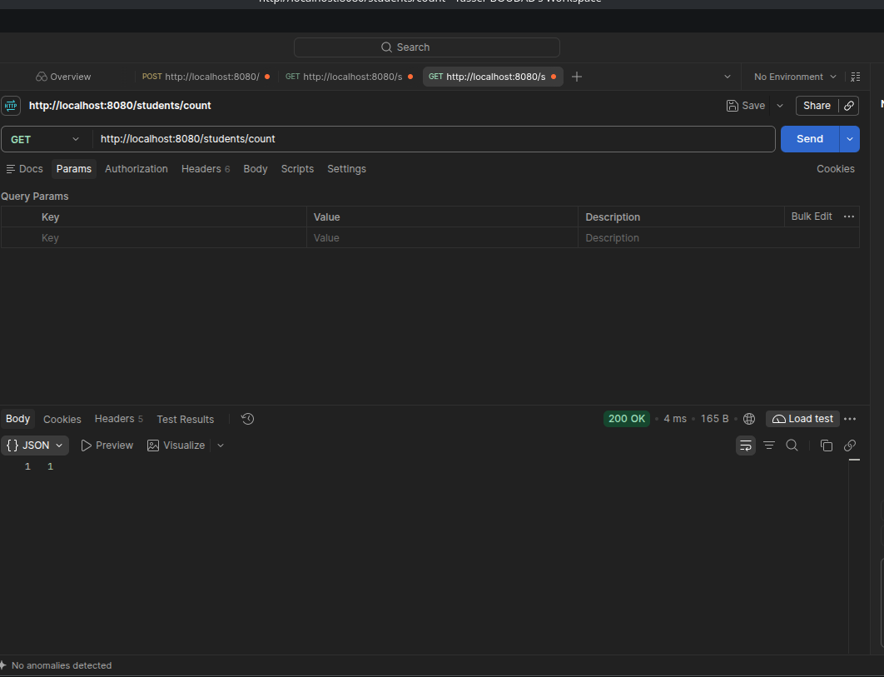
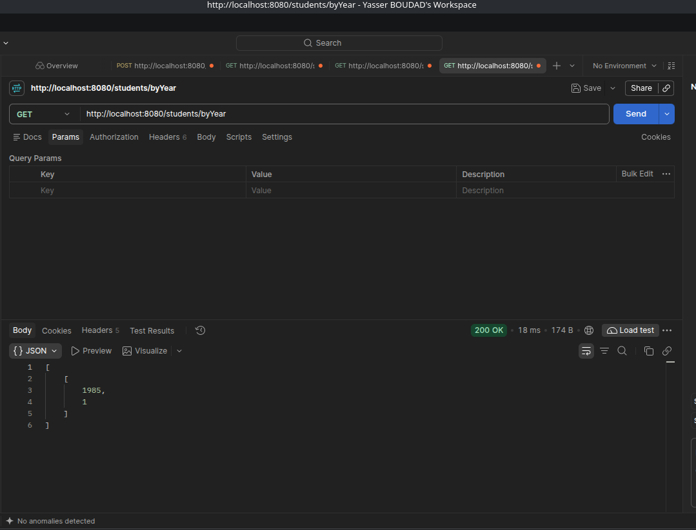
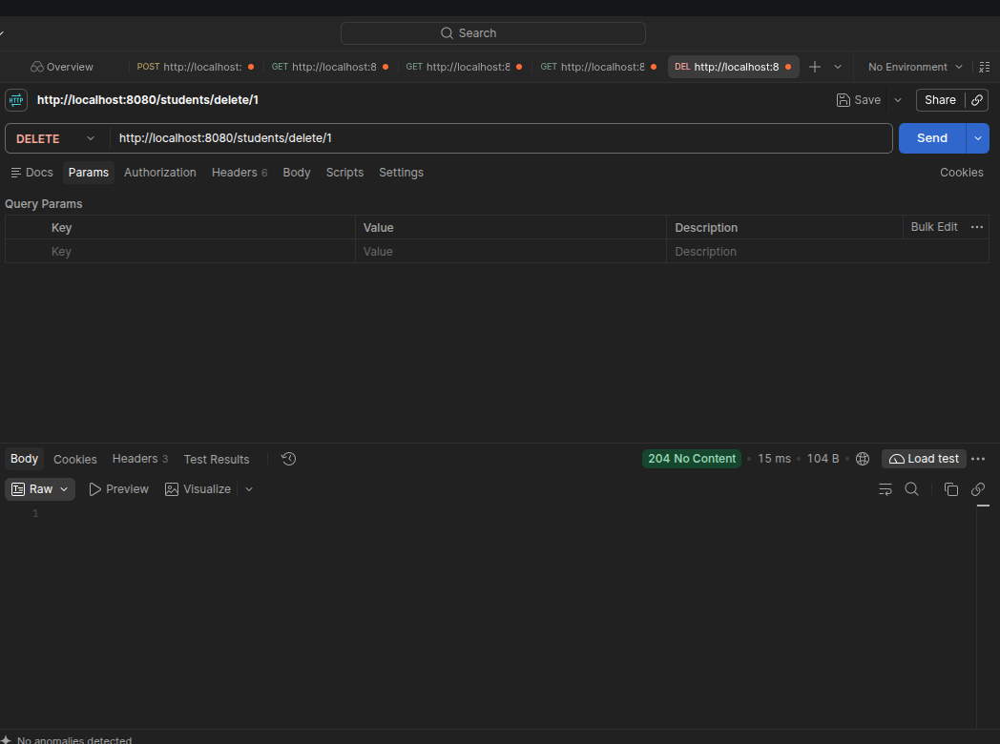
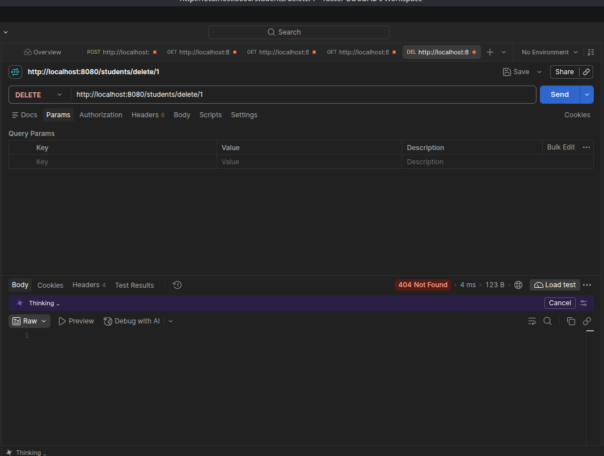
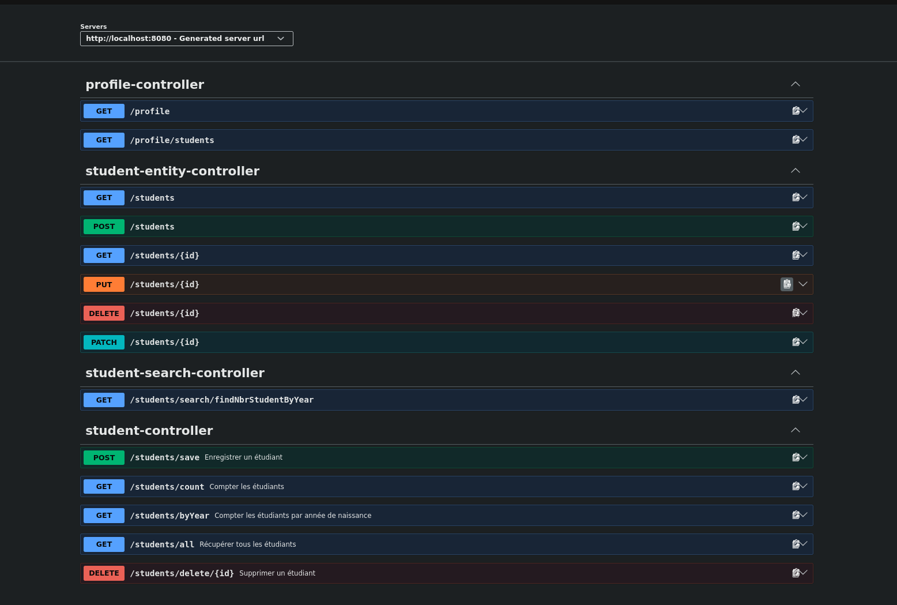
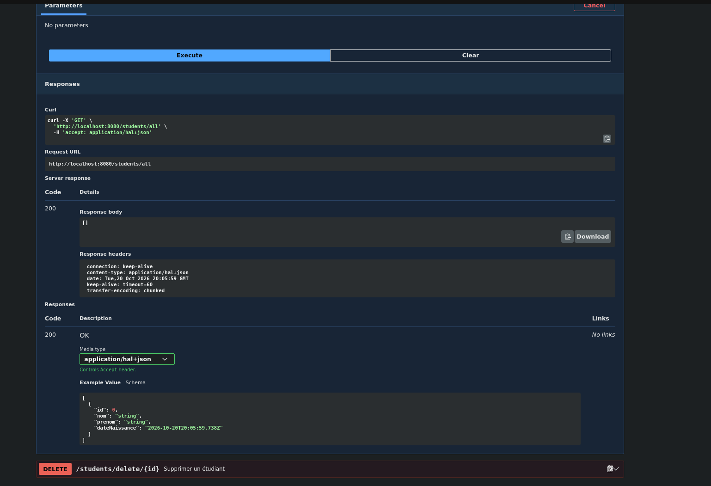

# TP6 : Spring Boot et Swagger

## 1. Tests unitaires

Nous avons execute `StudentControllerTest` dans IntelliJ avec JUnit 5 et Mockito. Les cinq tests passent : ajout, suppression, liste, comptage et regroupement par annee. Le service est simule avec Mockito pour verifier les reponses du controleur.

## 2. Lancement de l'application

Nous avons lance `StudentManagementApplication` dans IntelliJ. La console confirme la connexion a MariaDB et le demarrage de l'application sur le port `8080`. J'ai utilise MariaDB sur mon PC a la place de MySQL. Le mot de passe se configure avec `DB_PASSWORD` ou dans `src/main/resources/application-local.properties` (fichier local non versionne).

## 3. Tests de l'API avec Postman

### Ajout d'un etudiant

Nous avons envoye une requete `POST` vers `/students/save` avec le nom LACHGAR, le prenom Mohamed et la date de naissance `1985-09-01`. La reponse `201 Created` confirme l'ajout de l'etudiant avec l'identifiant `1`.

### Liste des etudiants

La requete `GET /students/all` retourne `200 OK`. La liste contient l'etudiant ajoute avec ses informations.

### Nombre d'etudiants

La requete `GET /students/count` retourne `200 OK` et la valeur `1`. Il y a donc un etudiant dans la base.

### Nombre d'etudiants par annee de naissance

La requete `GET /students/byYear` retourne `200 OK` avec `[[1985, 1]]`. Cela correspond a un etudiant ne en 1985.

### Suppression d'un etudiant

Nous avons envoye `DELETE /students/delete/1`. La reponse `204 No Content`, sans corps, confirme la suppression de l'etudiant.

### Suppression d'un etudiant inexistant

Nous avons renvoye la meme requete de suppression. Cette fois, la reponse est `404 Not Found`, car l'etudiant a deja ete supprime.

## 4. Documentation avec Swagger

Nous avons ouvert `http://localhost:8080/swagger-ui.html`. La section `student-controller` affiche les cinq routes avec leurs descriptions. Les autres sections sont generees automatiquement par Spring Data REST, une dependance demandee dans le TP.

### Test depuis Swagger

Nous avons teste `GET /students/all` avec les boutons `Try it out` puis `Execute`. La reponse est `200` avec une liste vide `[]`, car l'etudiant a ete supprime lors du test precedent.
